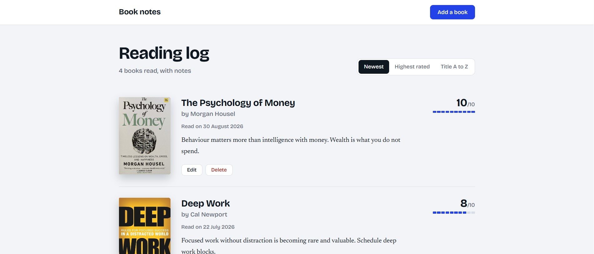

# Dogear



Dogear is a personal reading journal for the books you finish and the ideas you want to keep. Each reader gets a private library with notes, ratings, and reading dates.

## Landing page preview


## Features

- Create an account and sign in with a securely hashed password
- Keep each user's books and notes in a separate journal
- Start new accounts with an empty library
- Add, edit, and remove books, ratings, notes, and finished dates
- Search the collection and sort by recent read, rating, or title
- Load book covers from the Open Library Covers API, with a designed fallback
- Explore a responsive landing page with an About section

## Built with

Node.js, Express, EJS, PostgreSQL, Passport, bcrypt, Axios, HTML, and CSS

## Run locally

You'll need Node.js, npm, and PostgreSQL.

1. Install the project dependencies:

   ```bash
   npm install
   ```

2. Create a PostgreSQL database named `books`, then run `schema.sql` against it.

3. Create a `.env` file in the project root with your local database credentials and a session secret:

   ```env
   DB_USER=your_postgres_user
   DB_HOST=localhost
   DB_NAME=books
   DB_PASSWORD=your_postgres_password
   DB_PORT=5432
   SESSION_SECRET=replace-with-a-long-random-value
   ```

   `.env` is ignored by Git. Keep real credentials out of the repository.

4. Start the server:

   ```bash
   node index.js
   ```

5. Visit `http://localhost:3000`.

## Hosting

Dogear is an Express and EJS application with a PostgreSQL database, so GitHub Pages alone cannot run it. It needs a Node.js web host and a hosted PostgreSQL database. A free hobby setup can use Render for the app and Neon for PostgreSQL. Before deploying, configure the app to use the host-provided port and Neon connection string, then add the database credentials and `SESSION_SECRET` as hosting environment variables.

## What I learned

- Designing relational tables and writing parameterized SQL queries
- Associating every book with its owner and enforcing user-specific access
- Using Passport and bcrypt for account authentication
- Integrating a public covers API and handling missing results
- Structuring an Express app with EJS views and reusable partials
